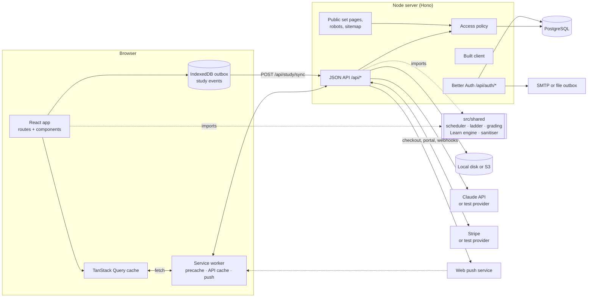
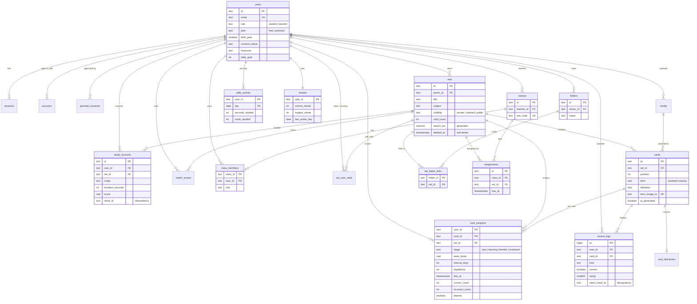

# Architecture

## Overview

One Node process serves everything: the JSON API, authentication, the built
single-page app, and server-rendered HTML for public set pages. The client is a
client-rendered React app. That split was chosen over a server-rendered
framework because the study modes have to run from data already on the device
(see "Studying and sync"), which is simple for a client-rendered app and
fragile for server-rendered routes.

| Layer | Choice |
| --- | --- |
| Client | React 19, TypeScript, Vite, Tailwind CSS v4, Radix primitives (shadcn-style components), React Router, TanStack Query |
| Server | Hono on Node, Zod validation, Pino logging |
| Data | PostgreSQL through Drizzle ORM, SQL migrations generated from the schema |
| Auth | Better Auth: email/password (scrypt), Google OAuth, verification, reset, database sessions |
| AI | Anthropic TypeScript SDK, structured outputs, behind a provider interface |
| Payments | Stripe Checkout and customer portal, behind a provider interface |
| Tests | Vitest (unit and API against real PostgreSQL), Playwright (browser, axe) |

## The shared core

`src/shared` holds everything that decides *what studying means*, as pure
TypeScript with no I/O:

- `srs.ts`: the SM-2-style scheduler (`again / hard / good / easy`).
- `study.ts`: study events and the mastery ladder (new → learning → familiar → mastered).
- `learn.ts`: the Learn mode state machine.
- `grading.ts`: typed-answer grading. `test.ts`: test generation and scoring.
- `richtext.ts`: the card markup sanitiser and parser.
- `import.ts`, `csv.ts`: bulk paste and CSV.

Both sides import the same functions. The browser applies an answer
immediately; the server applies the same answer with the same function and is
authoritative. That is what keeps optimistic updates and offline study honest.

## Studying and sync

1. An answer or rating becomes a `StudyEvent` with an id generated on the device.
2. The client applies it to the cached set (`applyEvent`) and appends it to an
   IndexedDB outbox that is kept per signed-in user.
3. The outbox is flushed to `POST /api/study/sync` in the background, and again
   whenever the connection returns.
4. The server takes a per-user advisory lock, skips events it has already
   stored (by id), sorts the rest by when they happened, applies them, appends
   to `review_logs`, updates daily totals and recomputes the streak, all in one
   transaction. It returns the resulting progress, which the client folds back
   into its cache.

Replaying a batch is harmless, two devices cannot interleave updates to a
card, and days synced late from an offline device still count toward a streak.

## Offline and the service worker

`src/client/sw.js` is turned into `dist/client/sw.js` at build time by a small
Vite plugin, which fills in the list of built files and a version hash, so
every deploy installs a new worker that precaches the whole app. At run time:

- **Navigations** go to the network, falling back to a cached copy of the
  bare app shell (`/shell`), so any route opens offline.
- **API reads** are network-first; successful JSON answers are kept in a
  trimmed cache, so sets, the dashboard and the review queue that were opened
  online still load offline. (API answers are `no-store` for browsers and
  proxies; this cache belongs to the app and is cleared at sign-out.) The data
  export and billing status are never kept.
- **Uploads** (`/api/media/:id`) are cache-first: they never change.
- **Premium downloads** put a set and all of its media in a separate cache
  that is never trimmed and is refreshed whenever the set is fetched online.
- Writes are never cached: study events go to the IndexedDB outbox (see
  above) and are sent when the connection returns.
- Everything cached for an account is deleted when it signs out or another
  account signs in on the device.
- `push` and `notificationclick` handlers show reminders and open the review
  queue.

## AI

`services/ai/` defines an `AiProvider` interface with four operations (make
cards, suggest a definition, example or memory trick, write wrong answers,
explain a wrong answer). The Anthropic implementation uses structured outputs
validated by Zod schemas, adaptive effort per task, a server-side refusal
fallback where the model supports it, and maps every failure (refusal,
overload, truncation) to an error the interface can explain. User material is
wrapped in tags and the model is told to treat it as data. The mock provider
is deterministic and only used when asked for.

Every request goes through `withAllowance`: email must be verified, a burst
limit applies, and a usage row is reserved under a per-user advisory lock
before the model is called (so parallel requests cannot exceed the monthly
allowance) and released if the call fails. The allowance comes from
`shared/entitlements.ts`. Wrong answers for multiple choice are cached per card
against a hash of its text, shared by everyone who studies the set, and
regenerated only when the card changes. Nothing the AI writes is saved until
the user accepts it, and AI-written cards carry a visible label.

## Billing and entitlements

`shared/entitlements.ts` is the only place plan differences are defined; the
server enforces them and the client reads the same object to decide what to
offer. `services/billing.ts` turns a provider's subscription state into
`users.plan` and `users.plan_expires_at` (period end plus a short grace
period), so a lapsed subscription falls back to free even if a webhook is
missed. Stripe webhooks are verified by signature, recorded by event id so
retries are harmless, and always re-read the subscription from Stripe because
events can arrive out of order. Deleting an account cancels its subscription.
The test provider grants Premium immediately and is refused in production.

## Classes

A class has one teacher (`classes.teacher_id`, also a `class_members` row with
the teacher role) and students who join with a code. Assigning a set to a
class is what shares it: `policies.ts` lets class members open a private set
only while it is assigned to an active (not archived) class they belong to,
so leaving, removal, archiving or unassigning revokes access at once. Class
progress is computed from `card_progress` and `set_user_state` for the
assigned sets; only the teacher can read it, and students are told that
before they join.

## Security model

- **Access policy in one place.** `services/policies.ts` decides who can see or
  change a set. Every route goes through it. A set that the viewer may not see
  answers `404`, never `403`, so its existence is not revealed. Uploaded media
  is readable exactly when a set that uses it is.
- **Card content.** Rich text is stored as an attribute-free subset of HTML
  (`<b> <i> <u> <s>   <mark> <code>  `). It is sanitised on every
  write and rendered by building elements from a parsed tree; stored text is
  never injected as HTML.
- **Requests.** Every body and query is validated with Zod. Session cookies are
  `HttpOnly`, `SameSite=Lax`. State-changing requests must come from the app's
  own origin. Responses carry a strict Content Security Policy in production.
- **Abuse limits.** One fixed-window rate limiter backed by PostgreSQL, so
  limits hold across instances; used by auth and by write endpoints. The
  client address comes from the socket, or `X-Forwarded-For` only when
  `TRUST_PROXY` is set, and is handed to Better Auth in a header the server
  always overwrites.
- **Uploads.** Type is decided from the file's bytes, not its name; only known
  image and audio formats are stored; quotas are reserved atomically.
- **Younger users.** Under-13 accounts are locked until a parent approves by
  emailed link, cannot publish publicly, and are not named on leaderboards.
  They cannot buy Premium.
- **Payments.** Card details never touch the server (Stripe Checkout and the
  customer portal). Webhooks are exempt from the origin check and are
  authenticated by Stripe's signature instead; each event is applied once.
- **Privacy.** Users can download everything held about them
  (`GET /api/me/export`) and delete their account, which cascades through the
  database, removes their uploaded files and cancels billing. Data cached on
  the device is cleared at sign-out. The free plan's promotion slot only ever
  promotes Premium: there is no third-party advertising or tracking.

## Configuration and deployment modes

`src/server/config.ts` reads every setting through one Zod schema in a pure
`parseEnv` function (unit-tested), and `env.ts` applies it to the process.
`APP_ENV` selects development, preview or production; the mode decides which
test providers are allowed, whether demo data and start-up migrations run,
whether search engines may index the site, and which missing secrets are
fatal. The client learns the mode from `/api/me` and shows a banner and
demo sign-in in previews. See `docs/DEPLOYMENT.md`.

## Request lifecycle

`requestContext` (request id, structured log line) → security headers →
`originGuard` → `sessionMiddleware` (resolves the cookie to a `Viewer` with plan
and age rules) → route → service → policy → database. Errors thrown as
`HttpError` are returned as `{ error: { code, message } }`; anything else is
logged, reported through `reportError`, and returned as a generic 500.

## Internationalisation and accessibility

Interface text lives in JSON catalogues under `src/client/locales/<locale>/`
with type-checked keys and ICU-style plurals; missing keys fall back to
English. Layout uses logical properties so it mirrors for right-to-left
locales, and card content uses `dir="auto"` so mixed-direction sets render
correctly. Colour tokens are checked against WCAG AA by
`npm run check:contrast`. Study modes are operable by keyboard and announce
results through live regions.

## Database

Generated from `src/server/db/schema.ts`; the migration is in `drizzle/`.

Also present: `verifications` (auth tokens), `ai_usage`, `subscriptions`,
`billing_events`, `push_subscriptions`, `rate_limits`, `storage_usage`.

Indexes that matter:

- `card_progress (user_id, due_at) WHERE due_at IS NOT NULL`: the daily review
  queue, "what is due for this user, oldest first".
- `sets USING gin (search_tsv)`: full-text search over title, subject,
  description and terms; `sets USING gin (title gin_trgm_ops)` for typo-tolerant
  and prefix title matching.
- `sets (subject, updated_at DESC) WHERE visibility = 'public' AND deleted_at IS NULL`:
  browse by subject.
- `cards (set_id, position)`; `review_logs (user_id, card_id, reviewed_at DESC)`
  for per-card history; unique `(user_id, client_event_id)` and
  `(user_id, client_id)` indexes that make sync idempotent.
