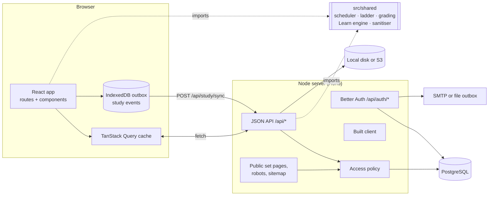

# Architecture

## Overview

One Node process serves everything: the JSON API, authentication, the built
single-page app, and server-rendered HTML for public set pages. The client is a
client-rendered React app. That split was chosen over a server-rendered
framework because the study modes have to run from data already on the device
(see "Studying and sync"), which is simple for a client-rendered app and
fragile for server-rendered routes.

| Layer | Choice |
| --- | --- |
| Client | React 19, TypeScript, Vite, Tailwind CSS v4, Radix primitives (shadcn-style components), React Router, TanStack Query |
| Server | Hono on Node, Zod validation, Pino logging |
| Data | PostgreSQL through Drizzle ORM, SQL migrations generated from the schema |
| Auth | Better Auth: email/password (scrypt), Google OAuth, verification, reset, database sessions |
| Tests | Vitest (unit and API against real PostgreSQL), Playwright (browser) |

## The shared core

`src/shared` holds everything that decides *what studying means*, as pure
TypeScript with no I/O:

- `srs.ts`: the SM-2-style scheduler (`again / hard / good / easy`).
- `study.ts`: study events and the mastery ladder (new → learning → familiar → mastered).
- `learn.ts`: the Learn mode state machine.
- `grading.ts`: typed-answer grading. `test.ts`: test generation and scoring.
- `richtext.ts`: the card markup sanitiser and parser.
- `import.ts`, `csv.ts`: bulk paste and CSV.

Both sides import the same functions. The browser applies an answer
immediately; the server applies the same answer with the same function and is
authoritative. That is what keeps optimistic updates and offline study honest.

## Studying and sync

1. An answer or rating becomes a `StudyEvent` with an id generated on the device.
2. The client applies it to the cached set (`applyEvent`) and appends it to an
   IndexedDB outbox that is kept per signed-in user.
3. The outbox is flushed to `POST /api/study/sync` in the background, and again
   whenever the connection returns.
4. The server takes a per-user advisory lock, skips events it has already
   stored (by id), sorts the rest by when they happened, applies them, appends
   to `review_logs`, updates daily totals and recomputes the streak, all in one
   transaction. It returns the resulting progress, which the client folds back
   into its cache.

Replaying a batch is harmless, two devices cannot interleave updates to a
card, and days synced late from an offline device still count toward a streak.

## Security model

- **Access policy in one place.** `services/policies.ts` decides who can see or
  change a set. Every route goes through it. A set that the viewer may not see
  answers `404`, never `403`, so its existence is not revealed. Uploaded media
  is readable exactly when a set that uses it is.
- **Card content.** Rich text is stored as an attribute-free subset of HTML
  (`<b> <i> <u> <s>   <mark> <code>  `). It is sanitised on every
  write and rendered by building elements from a parsed tree; stored text is
  never injected as HTML.
- **Requests.** Every body and query is validated with Zod. Session cookies are
  `HttpOnly`, `SameSite=Lax`. State-changing requests must come from the app's
  own origin. Responses carry a strict Content Security Policy in production.
- **Abuse limits.** One fixed-window rate limiter backed by PostgreSQL, so
  limits hold across instances; used by auth and by write endpoints.
- **Uploads.** Type is decided from the file's bytes, not its name; only known
  image and audio formats are stored; quotas are reserved atomically.
- **Younger users.** Under-13 accounts are locked until a parent approves by
  emailed link, cannot publish publicly, and are not named on leaderboards.

## Request lifecycle

`requestContext` (request id, structured log line) → security headers →
`originGuard` → `sessionMiddleware` (resolves the cookie to a `Viewer` with plan
and age rules) → route → service → policy → database. Errors thrown as
`HttpError` are returned as `{ error: { code, message } }`; anything else is
logged, reported through `reportError`, and returned as a generic 500.

## Internationalisation and accessibility

Interface text lives in JSON catalogues under `src/client/locales/<locale>/`
with type-checked keys and ICU-style plurals; missing keys fall back to
English. Layout uses logical properties so it mirrors for right-to-left
locales, and card content uses `dir="auto"` so mixed-direction sets render
correctly. Colour tokens are checked against WCAG AA by
`npm run check:contrast`. Study modes are operable by keyboard and announce
results through live regions.

## Database

Generated from `src/server/db/schema.ts`; the migration is in `drizzle/`.

Also present: `verifications` (auth tokens), `ai_usage`, `subscriptions`,
`billing_events`, `push_subscriptions`, `rate_limits`, `storage_usage`.

Indexes that matter:

- `card_progress (user_id, due_at) WHERE due_at IS NOT NULL`: the daily review
  queue, "what is due for this user, oldest first".
- `sets USING gin (search_tsv)`: full-text search over title, subject,
  description and terms; `sets USING gin (title gin_trgm_ops)` for typo-tolerant
  and prefix title matching.
- `sets (subject, updated_at DESC) WHERE visibility = 'public' AND deleted_at IS NULL`:
  browse by subject.
- `cards (set_id, position)`; `review_logs (user_id, card_id, reviewed_at DESC)`
  for per-card history; unique `(user_id, client_event_id)` and
  `(user_id, client_id)` indexes that make sync idempotent.
